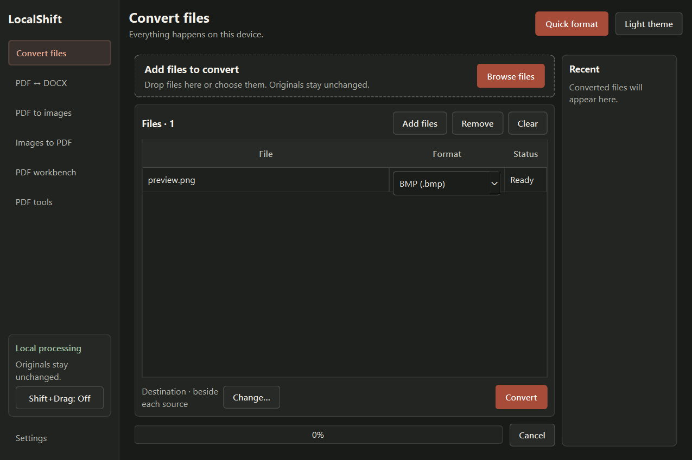
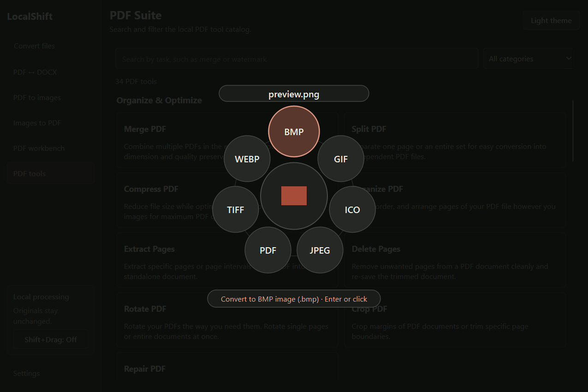
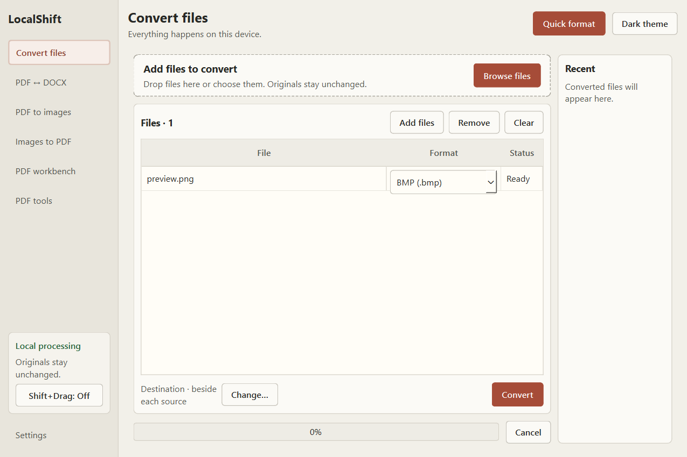
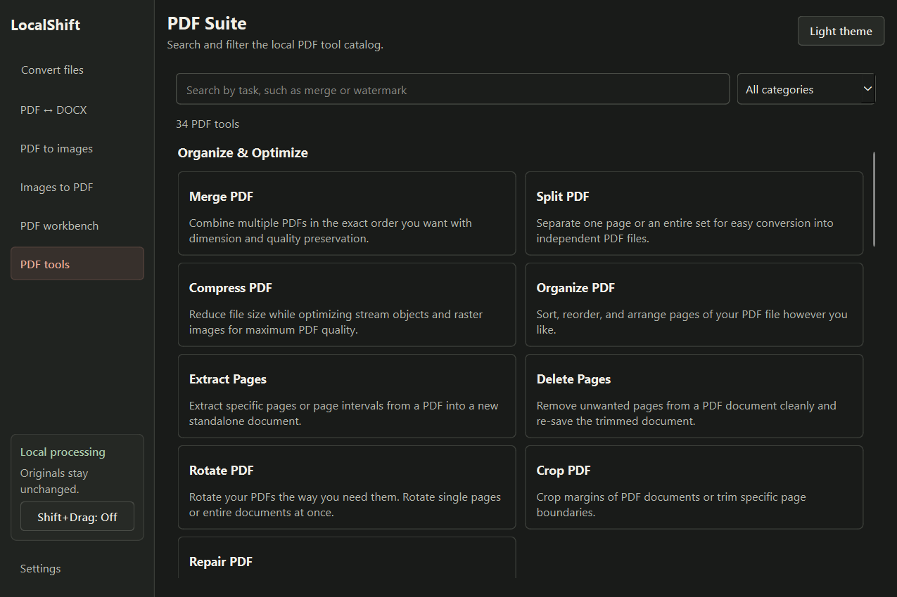
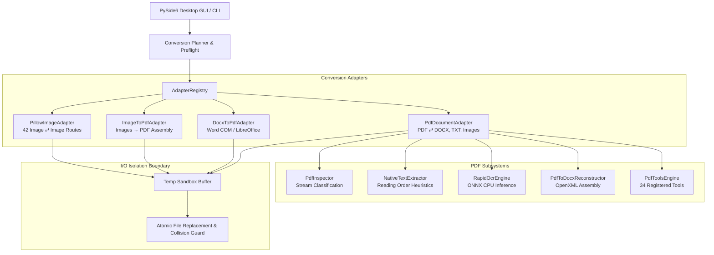

# LocalShift

**Offline-First Desktop File Converter & PDF Productivity Suite for Windows.**
*Zero telemetry. 100% local hardware processing. Immutable source files.*

---

[-0078D4.svg)](#requirements)
[-3776AB.svg)](#getting-started)
[](LICENSE)
[-41CD52.svg)](#architecture)
[-informational.svg)](#privacy--security)
[](#testing--verification)

---


*Current dark-theme converter capture at 1020×680. The queue contains a non-sensitive sample image.*

---

## The Idea

Modern file conversion should not require surrendering confidential documents, legal contracts, or personal photographs to third-party web servers.

Web-based converters frequently impose artificial file size throttles, rate limits, queue wait times, and opaque data retention policies. Furthermore, many desktop alternatives are cluttered with intrusive advertising, background telemetry, or mandatory cloud logins.

**LocalShift** was engineered from first principles as an uncompromising, Windows-native, offline-first file conversion utility:
- **Absolute Privacy**: Conversion engines, document reconstruction pipelines, and OCR models execute entirely on your local CPU. Zero network sockets are opened during processing.
- **Data Preservation**: Input files are treated as read-only, immutable assets. Outputs are generated into isolated temporary workspaces and committed via atomic filesystem operations.
- **Desktop Workflow Acceleration**: Features both a multi-format batch conversion queue and an innovative radial quick-action menu designed to minimize workflow friction.
- **Genuine Utility**: Includes 34 PDF tools: 32 ready to use and 2 requiring local configuration. They cover document restructuring, OpenXML conversion, ISO 19005-1 PDF/A compliance, digital signing, and irreversible text redaction.

---

## Key Features

### 1. Robust File Conversion Engine (54 Verified Routes)
- **42 Pairwise Image Routes**: Lossless and high-fidelity conversions across `PNG`, `JPEG`, `WebP`, `BMP`, `TIFF`, `GIF`, and `ICO`.
- **12 Document & Interchange Routes**: Bidirectional transformations between `PDF`, `DOCX`, plain text (`TXT`), and raster images.
- **Content-Based Format Sniffing**: Inspects true binary magic bytes rather than relying blindly on file extensions.
- **Atomic Placement & Collision Avoidance**: Output files are written to safe temporary buffers and renamed atomically. Collisions resolve automatically with deterministic ` (1)`, ` (2)` numbering without destructive overwrites.

### 2. Comprehensive PDF Productivity Suite
- **Organize & Optimize**: Split, merge, reorder, burst, lossless margin crop, delete pages, rotate (90°/180°/270°), stream-level compression, and structural repair of damaged xref tables.
- **Format Conversion**: Convert PDFs to editable Microsoft Word (`DOCX`), OpenXML Excel (`XLSX`), OpenXML PowerPoint (`PPTX`), ISO 19005-1 compliant `PDF/A`, Markdown (`MD`), and high-DPI raster images (`PNG`/`JPEG`).
- **Document Authoring**: Headless generation of PDFs from Word documents, Excel workbooks, PowerPoint presentations, HTML layouts, and ordered multi-image assemblies.
- **Security & Integrity**: Password decryption/unlocking, digital verification seal generation with SHA-256 integrity fingerprints, custom text/graphic watermarking, and dynamic page numbering.
- **Advanced Document Processing**: Irreversible vector/font-purged redaction, AcroForm data extraction/filling, side-by-side textual diff reports, and an offline TextRank sentence summarizer.

### 3. Radial Quick-Action Wheel
- **Frictionless Conversion**: Invoke a precision radial menu to instantly convert files without navigating complex nested dialogs.
- **Visual File Hub**: Displays live thumbnail previews, primary filename pills, human-readable file sizes, and multi-file batch indicators.
- **Dual Activation Modes**: Available within the main window drag-zone or via an optional, user-confirmed global `Shift + Drag` gesture.
- **Keyboard & Mouse Navigation**: Full accessibility support using `Tab`, `Arrow Keys`, numeric shortcuts (`1`–`9`), `Enter` to commit, or `Esc` to cancel.

### 4. Color-Accurate Rendering & High-Resolution OCR
- **Calibrated Color Pipeline**: Byte-order rectified PDF rendering engine eliminates Red/Blue channel inversions, guaranteeing color fidelity across all raster exports.
- **Local Neural OCR**: Bundled RapidOCR ONNX Runtime engine extracts text from scanned or rotated pages locally, with automated 90°/180°/270° orientation recovery.

### 5. Thoughtful Desktop Experience
- **Print-Room Proof Sheet Visual System**: Curated Dark Slate and Light Paper colorways with restrained rust accents, high-contrast typography, and zero visual clutter.
- **Persistent Destination Policies**: Configure an explicit "Save to Folder" destination (similar to LocalSend) or save adjacent to original source files.
- **Inline Action Triggers**: Completed queue jobs offer one-click "Open File" and "Open Folder" actions.

---

## Supported Format Matrix

LocalShift supports **54 directional conversion routes**. Conversion capabilities are strictly bounded: a route is available only when an audited, offline adapter is registered and all local system prerequisites are met.

| Format Key | Category | Standard Extensions | Magic Byte Detection | LocalShift Role |
|:---|:---|:---|:---|:---|
| **`png`** | Raster Image | `.png` | `\x89PNG\r\n\x1a\n` | Input & Output |
| **`jpeg`** | Raster Image | `.jpeg`, `.jpg` | `\xff\xd8\xff` | Input & Output |
| **`webp`** | Raster Image | `.webp` | `RIFF....WEBP` | Input & Output |
| **`bmp`** | Raster Image | `.bmp` | `BM` | Input & Output |
| **`tiff`** | Raster Image | `.tiff`, `.tif` | `II*\x00` / `MM\x00*` | Input & Output |
| **`gif`** | Raster Image | `.gif` | `GIF87a` / `GIF89a` | Input & Output |
| **`ico`** | Windows Icon | `.ico` | `\x00\x00\x01\x00` | Input & Output |
| **`pdf`** | Document | `.pdf` | `%PDF-` | Input & Output |
| **`docx`** | Word Document | `.docx` | `PK\x03\x04` + `word/document.xml` | Input & Output |
| **`txt`** | Plain Text | `.txt` | Plain UTF-8 text stream | Output Only |

### Supported Directional Routes (54 Total)

```
                     ┌──────────────────────────────────────────────┐
                     │          Raster Image Suite (42 Routes)      │
                     │  PNG ⇄ JPEG ⇄ WebP ⇄ BMP ⇄ TIFF ⇄ GIF ⇄ ICO  │
                     └──────────────────────┬───────────────────────┘
                                            │
               Ordered Multipage Assembly   │   High-DPI Page Rasterization
               (7 Image → PDF Routes)       │   (PDF → PNG / JPEG)
                                            ▼
┌─────────────────┐    Native / RapidOCR    ┌─────────────────┐    LibreOffice / COM    ┌─────────────────┐
│                 │ ──────────────────────> │                 │ <────────────────────── │                 │
│   Plain Text    │                         │       PDF       │                         │   Office DOCX   │
│     (.txt)      │                         │     (.pdf)      │ ──────────────────────> │     (.docx)     │
└─────────────────┘                         └─────────────────┘    Structure Extraction └─────────────────┘
```

#### Route Rules & Constraints:
- **`ico` Generation**: Automatically clamps and resamples inputs to standard Windows square dimensions (up to 256×256 pixels) using high-quality Lanczos interpolation with RGBA preservation.
- **`jpeg` Transparency**: Transparent alpha layers are composited against a clean background (default solid white `#FFFFFF`).
- **`gif` Palette Preservation**: Generates adaptive 256-color palettes preserving single-frame binary transparency.
- **`docx` → `pdf`**: Requires local Microsoft Word COM automation or headless LibreOffice (`soffice.exe`) installed on the Windows host.
- **Identity Routes**: Same-format conversions (e.g. `png` → `png`) are detected and rejected as no-ops.

---

## A Look Inside

| Main Workbench (Dark Slate) | Radial Conversion Wheel |
|:---:|:---:|
|  |  |
| *Current dark-theme converter capture at 1020×680.* | *Current in-app radial-wheel capture. The background is dimmed while the menu is active.* |

| Light Paper Visual Theme | PDF Tool Catalog |
|:---:|:---:|
|  |  |
| *Current light-theme converter capture at 1020×680.* | *Current dark-theme PDF catalog, showing the live registry count.* |

Settings retain explicit global-gesture opt-in and an OFF status by default. See the [Milestone 24 report](docs/reports/LS-BE-024-release-readiness.md) for what was and was not physically verified.

---

## PDF Productivity Suite Reference

The PDF Suite provides 34 registered tools: 32 ready to use and 2 requiring local configuration. Availability states are reported transparently:
- **`READY`**: 100% functional out-of-the-box using bundled local engines.
- **`CONFIG_REQUIRED`**: Fully implemented locally, but requires an external third-party binary or local model weights.

| Tool Name | Category | Status | Engine / Backend | Verification Coverage |
|:---|:---|:---:|:---|:---:|
| **Merge PDF** | Organize & Optimize | `READY` | Google PDFium (`pypdfium2`) | Unit, Integration & UI |
| **Split PDF** | Organize & Optimize | `READY` | Google PDFium (`pypdfium2`) | Unit, Integration & UI |
| **Compress PDF** | Organize & Optimize | `READY` | Stream optimization & orphan removal | Unit, Integration & UI |
| **Organize PDF** | Organize & Optimize | `READY` | 1-based page index permutation | Unit, Integration & UI |
| **Extract Pages** | Organize & Optimize | `READY` | Discrete page range extraction | Unit, Integration & UI |
| **Delete Pages** | Organize & Optimize | `READY` | Safe index-based page exclusion | Unit, Integration & UI |
| **Rotate PDF** | Organize & Optimize | `READY` | 90°/180°/270° vector rotation | Unit, Integration & UI |
| **Crop PDF** | Organize & Optimize | `READY` | Lossless vector cropbox margin adjustment | Unit, Integration & UI |
| **Repair PDF** | Organize & Optimize | `READY` | Stream reconstruction for corrupted xrefs | Unit, Integration & UI |
| **PDF to Word** | Convert from PDF | `READY` | Structural reconstruction (`python-docx`) | Unit, Holdout & Visual QA |
| **PDF to JPG** | Convert from PDF | `READY` | High-DPI rasterization (`pypdfium2` + Pillow) | Unit, Integration & UI |
| **PDF to PNG** | Convert from PDF | `READY` | Color-calibrated lossless rasterization | Unit, Integration & UI |
| **PDF to Markdown** | Convert from PDF | `READY` | Header, table & list stream parser | Unit, Integration & UI |
| **PDF to PowerPoint** | Convert from PDF | `READY` | Standalone OpenXML `.pptx` generator | Unit, Integration & UI |
| **PDF to Excel** | Convert from PDF | `READY` | Pure-Python OpenXML `.xlsx` builder | Unit, Integration & UI |
| **PDF to PDF/A** | Convert from PDF | `READY` | ISO 19005-1 compliance via Word COM / XMP | Unit, Integration & UI |
| **Word to PDF** | Convert to PDF | `READY` | Headless Word COM or LibreOffice | Unit, Integration & UI |
| **JPG to PDF** | Convert to PDF | `READY` | Single/multipage assembly with margin control | Unit, Integration & UI |
| **PowerPoint to PDF**| Convert to PDF | `READY` | Headless PowerPoint COM or LibreOffice | Unit, Integration & UI |
| **Excel to PDF** | Convert to PDF | `READY` | Headless Excel COM or LibreOffice | Unit, Integration & UI |
| **HTML to PDF** | Convert to PDF | `READY` | PySide6 `QTextDocument` / `QPdfWriter` | Unit, Integration & UI |
| **Scan to PDF** | Convert to PDF | `READY` | Ordered image collection compiler | Unit, Integration & UI |
| **Page Numbers** | Security & Pages | `READY` | Dynamic numbering badge overlay | Unit, Integration & UI |
| **Watermark** | Security & Pages | `READY` | Configurable text/opacity vector watermark | Unit, Integration & UI |
| **Protect PDF** | Security & Pages | `CONFIG_REQUIRED` | Requires local QPDF binary on `PATH` | Unit & Diagnostic |
| **Unlock PDF** | Security & Pages | `READY` | Password security handler removal | Unit, Integration & UI |
| **OCR PDF** | Security & Pages | `READY` | Offline RapidOCR ONNX Runtime engine | Unit, Integration & UI |
| **Edit PDF** | Advanced & AI | `READY` | Text annotations, stamps & highlights | Unit, Integration & UI |
| **Sign PDF** | Advanced & AI | `READY` | Verification seal with SHA-256 fingerprint | Unit, Integration & UI |
| **Compare PDF** | Advanced & AI | `READY` | Side-by-side textual diff Markdown report | Unit, Integration & UI |
| **Redact PDF** | Advanced & AI | `READY` | Permanent text purging & vector destruction | Unit, Integration & UI |
| **PDF Forms** | Advanced & AI | `READY` | AcroForm field reader & JSON schema exporter | Unit, Integration & UI |
| **AI Summarizer** | Advanced & AI | `READY` | Offline TextRank graph sentence ranking | Unit, Integration & UI |
| **Translate PDF** | Advanced & AI | `CONFIG_REQUIRED` | Requires local MarianMT ONNX model directory | Unit & Diagnostic |

---

## Getting Started

### System Requirements
- **Operating System**: Windows 10 or Windows 11 (64-bit AMD64).
- **Python Runtime**: Python 3.10, 3.11, or 3.12 (Python 3.11.9 recommended).
- **PowerShell**: PowerShell 5.1 or PowerShell 7+.
- **Optional Backends**:
  - Microsoft Office (Word, Excel, PowerPoint) or LibreOffice 7+ for Office document conversions.
  - QPDF (CLI) for encrypting password-protected PDFs (`protect_pdf`).

### Installation from Source

1. **Clone the repository**:
   ```powershell
   git clone https://github.com/localshift/localshift.git
   Set-Location localshift
   ```

2. **Create and activate an isolated virtual environment**:
   ```powershell
   py -3.11 -m venv .venv
   .\.venv\Scripts\Activate.ps1
   ```

3. **Install dependencies**:
   ```powershell
   # Install core converter, CLI, desktop GUI, and test dependencies
   python -m pip install --upgrade pip
   python -m pip install -e ".[dev,desktop]"
   ```

   *Network note: If `pip install` times out reaching PyPI, you may specify an audited regional mirror:*
   ```powershell
   python -m pip install -e ".[dev,desktop]" -i https://mirrors.aliyun.com/pypi/simple/ --trusted-host mirrors.aliyun.com
   ```

4. **Launch LocalShift**:
   ```powershell
   # Start the graphical desktop application
   python -m localshift.gui

   # Or verify command-line interface execution
   localshift --help
   ```

---

## How to Use

### 1. In-App Batch Conversion
1. Launch `python -m localshift.gui`.
2. Drag and drop any collection of supported files into the **General File Converter** queue.
3. Select your intended target format from the dropdown (the menu automatically restricts options to valid routes for that specific file).
4. Optionally adjust conversion parameters (DPI, JPEG quality, OCR routing) in the options drawer.
5. Click **Convert All**. Output files are generated cleanly without modifying your originals.
6. Click **Open File** or **Open Folder** directly from the completion card.

### 2. PDF Productivity Suite
1. Switch to the **PDF Suite** tab on the left sidebar navigation.
2. Filter the catalog using category pills (`Organize`, `Convert from PDF`, `Convert to PDF`, `Security`, `Advanced & AI`) or search by tool title.
3. Click any tool card (e.g. *PDF to Excel*, *Sign PDF*, *Redact PDF*, or *AI Summarizer*).
4. Configure required options (e.g. signer name, redaction query, page numbers, or summary length) and click **Execute Tool**.

### 3. Radial Quick-Action Wheel
- **In-App Usage**: Drag any file over the designated drop-zone inside the LocalShift window. The radial wheel will smoothly project available format petals around your cursor. Hover over your desired petal and release to trigger instant conversion.
- **Global Shift+Drag (Optional Opt-In)**:
  - Open **Settings** in the desktop application.
  - Check **Enable global Shift+Drag conversion** (disabled by default).
  - On Windows and source applications that provide the required local-file OLE payload, hold `Shift` while dragging. Physical compatibility has not been certified across applications or systems.
  - Drop the file onto a petal to convert immediately to your default save destination.
  - *Safety behavior*: Conversion is dispatched only from a validated local-file payload and an explicit drop on an active petal. Explorer selection is never used as a substitute. The feature does not poll clipboard contents or inject hooks into foreign processes.
  - *Verification status*: Explorer, Desktop, third-party file-manager, mixed-DPI and physical assistive-technology behavior remain unverified. Consult the Milestone 24 report before relying on global gesture compatibility.

### 4. Command-Line Interface (CLI)
LocalShift includes a standalone command-line executable for automation and scripting:

```powershell
# Convert a single image
localshift convert .\document.png --to webp --output-dir .\out

# High-DPI PDF page rasterization
localshift convert .\manual.pdf --to png --output-dir .\pages

# Convert PDF to structured Word document
localshift convert .\contract.pdf --to docx

# Inspect file capabilities and format validity
localshift plan .\photo.jpeg --to png
```

---

## Architecture

LocalShift follows a decoupled, layered architecture where the conversion backend remains strictly independent of the presentation layer.



### Core Architectural Layers
- **Core Engine (`localshift.converter`)**: Controls execution lifecycles, path reservations, format sniffing, temporary file lifecycle, and atomic replacement.
- **Adapter Registry (`localshift.registry`)**: Maintains thread-safe registration of conversion adapters conforming to the `ConversionAdapter` protocol.
- **Document Foundation (`localshift.documents`)**: Encapsulates Google PDFium bindings, structural document reconstruction, table recovery heuristics, and local neural OCR inference.
- **PDF Tools Engine (`localshift.documents.pdf_tools_engine`)**: Provides 32 ready-to-use PDF operations and 2 configuration-dependent registrations, including custom OpenXML packaging.
- **Desktop UI (`localshift.gui`, `localshift.pdf_suite_ui`, `localshift.radial_menu`)**: Hardware-accelerated PySide6 interface featuring dynamic model-view queues, asynchronous `QThread` workers, and mathematical polar-coordinate radial hit-testing.

---

## Privacy, Security & Resource Boundaries

LocalShift was engineered for sensitive computing environments where data exfiltration and software reliability are critical concerns:

1. **Zero External Communication**:
   - The application opens zero network sockets during conversion and document processing.
   - All OCR models and font metrics reside locally on disk.
   - No telemetry, analytics, tracking pings, or crash-reporting packets are ever transmitted.

2. **Hardened Resource Ceilings**:
   - **File Size Ceiling**: Rejects input files exceeding **250 MiB** (`MAX_INPUT_BYTES`) to prevent host memory exhaustion.
   - **Document Page Bound**: Bounded to **2,000 pages** per PDF document to guard against unbounded allocation loops.
   - **Raster Buffer Ceiling**: Clamps rendering resolution between 72 and 400 DPI, enforcing a strict **16,000,000 pixel (~48 MB buffer)** ceiling per page.
   - **Bounded Memory Queues**: Asynchronous worker queues are bounded to 200 pending items and 1,000 completed records with FIFO eviction.

3. **Filesystem Defense**:
   - Source files are opened strictly in read-only mode and are never modified in-place.
   - Conversions write to unique, volume-local temporary buffers (`.tmp`) and commit via atomic `os.replace` semantics.
   - Output path reservation locks prevent concurrent worker threads from colliding on the same destination filename.
   - Dangling symlinks, special system devices, and path traversal attempts are detected and trapped during preflight inspection.

4. **Safety Disclosures**:
   - Global Shift+drag monitoring polls low-level Win32 keyboard/mouse states (`GetAsyncKeyState`) only when explicitly enabled by the user in Settings.
   - Shell integration writes standard file association verbs exclusively under the current user registry hive (`HKEY_CURRENT_USER\Software\Classes`). No administrator privileges or system-wide hooks are required.

---

## Testing & Verification

LocalShift maintains an exhaustive automated testing suite with verified test coverage across conversion mechanics, document formatting, visual rendering, error trapping, and packaging integrity.

### Reproducible Test Execution

```powershell
# Create the intended Python 3.11 environment and install declared extras
py -3.11 -m venv .venv
.\.venv\Scripts\python.exe -m pip install -e ".[dev,desktop,build]"

# Execute the complete automated regression suite
.\scripts\run_tests.ps1

# Or run pytest directly
$env:PYTHONPATH = "Z:\LocalShift;Z:\LocalShift\src"
$env:QT_QPA_PLATFORM = "offscreen"
.\.venv\Scripts\python.exe -m pytest -ra -q
```

### Verified Test Results

The current Milestone 24 totals and environment are recorded in
[`docs/reports/LS-BE-024-release-readiness.md`](docs/reports/LS-BE-024-release-readiness.md). The full run used the
project `.venv` and `.\scripts\run_tests.ps1`. Three skipped tests require Windows symlink privileges (Developer
Mode or elevation); skipped tests are not counted as passes.

### Conversion Quality Gate Standards
To ensure conversions meet publishing standards, LocalShift is benchmarked against holdout document corpuses:
- **Digital Text Documents**: Character Error Rate ($\text{CER}$) = $0.0\%$, Word Error Rate ($\text{WER}$) = $0.0\%$.
- **Financial Schedules & Tables**: $100\%$ table geometry recovery, $\text{CER} \le 3.5\%$.
- **Scanned Text (Upright & Inverted)**: RapidOCR local inference achieves $\text{CER} \le 4.4\%$ with automated 180° rotation recovery.
- **Multilingual Unicode Preservation**: $100\%$ character match across accented European Latin, Cyrillic, and Asian glyphs.

---

## Packaging & Windows Distribution

LocalShift provides an automated packaging pipeline for a portable directory and, when Inno Setup is installed, an
installer. The isolated build requires fresh output, work, and installer directories; it refuses to overwrite any.

```powershell
# Use new, unused paths outside existing release output folders
.\.venv\Scripts\python.exe packaging\build.py `
  --output-dir "$env:TEMP\LocalShift-build\dist" `
  --work-dir "$env:TEMP\LocalShift-build\work" `
  --installer-dir "$env:TEMP\LocalShift-build\installer"
```

- Output is placed under the chosen distribution path in `LocalShift\LocalShift.exe` (GUI) and
  `LocalShift\localshift-cli.exe` (CLI).
- If Inno Setup 6 is unavailable, pass `--skip-installer` and omit `--installer-dir`.
- Do not use the historical `--clean-only` option against directories containing files you need; it removes the
  repository's standard `build`, `dist\LocalShift`, and `dist\installer` directories.
- PyInstaller is pinned by the `[build]` extra. Application runtime dependencies remain version-ranged in
  `pyproject.toml`; a complete dependency lockfile is not currently provided.

---

## Project Roadmap

- [x] **Core Format Engine (Milestones 1–5)**: 42 image routes, asynchronous job queue, preflight validation, collision defense.
- [x] **Document Foundation (Milestones 6–8)**: Google PDFium extraction, RapidOCR integration, structured DOCX reconstruction, holdout quality benchmarks.
- [x] **Interchange & Workbench (Milestones 9–13)**: DOCX → PDF headless rendering, raster page export, ordered image assembly, PDF workbench.
- [x] **Windows Integration (Milestones 14–17)**: PyInstaller packaging, Inno Setup installer, Windows context menu verbs, radial conversion menu.
- [x] **Reliability & 54 Route Audit (Milestone 18)**: Color fidelity calibration, 54-route regression validation, zero unhandled exceptions.
- [x] **Complete PDF Suite (Milestone 19)**: All 32 PDF productivity tools implemented with native OpenXML builders, ISO PDF/A exporter, and offline AI summarizer.
- [x] **Radial Wheel Geometry Stabilization (Milestone 22A)**: Synchronous resize geometry, unified petal hit-testing, and proof-sheet visual theme.
- [ ] **Release Readiness (Milestones 23–24)**: Automated regression and a clean-environment current-source build are recorded in the release report; Explorer/Desktop/third-party drag, mixed-DPI, assistive-technology, and installer lifecycle verification remain release gates.
- [ ] **Advanced Format Expansion**: Ingesting legacy `.doc`, standalone spreadsheet data extraction, and vector SVG rasterization.

---

## Contributing

Contributions from engineers who value software craftsmanship, clean code, and user privacy are welcome.

### Development Guidelines
1. **The Smallest Complete Change**: Solve the core problem with minimal code. Avoid speculative abstractions, unnecessary wrapper types, or unrequested configuration layers.
2. **Offline Integrity**: Never introduce dependencies or workflows that initiate outbound network calls or rely on cloud APIs.
3. **Safety Boundaries**: Preserve all input validation, file size bounds, memory caps, atomic replacement semantics, and collision avoidance locks.
4. **Verification**: Every non-trivial change must include regression tests. Ensure `.\scripts\run_tests.ps1` runs cleanly before opening a pull request.

---

## License & Third-Party Attributions

LocalShift is open-source software licensed under the **[MIT License](LICENSE)**.

### Third-Party Components & Licenses
LocalShift stands on the shoulders of audited open-source libraries:
- **[PySide6](https://wiki.qt.io/Qt_for_Python)** (The Qt Company) — *LGPLv3*
- **[Google PDFium](https://pdfium.googlesource.com/pdfium/)** via **[pypdfium2](https://github.com/pypdfium2-team/pypdfium2)** — *Apache-2.0 / BSD-3-Clause*
- **[Pillow](https://python-pillow.org/)** — *HPND*
- **[RapidOCR](https://github.com/RapidAI/RapidOCR)** & **[ONNX Runtime](https://onnxruntime.ai/)** — *Apache-2.0 / MIT*
- **[python-docx](https://github.com/python-openxml/python-docx)** — *MIT*

---

## Project Documentation

For in-depth technical documentation, specifications, and audit reports, refer to the project docs:
- **[Format Support Specification](docs/FORMAT_SUPPORT.md)** — Exhaustive 54-route matrix, option specifications, and PDF tool registry details (34 registered: 32 ready, 2 configuration-required).
- **[System Architecture](docs/ARCHITECTURE.md)** — Architectural overview, memory isolation boundaries, and reading-order heuristics.
- **[Project Status & History](docs/PROJECT_STATUS.md)** — Complete chronological engineering log and milestone release notes.
- **[Changelog](CHANGELOG.md)** — Detailed version history adhering to Keep a Changelog.
- **[Work Reports](docs/reports/)** — Engineering verification reports and benchmark data.

---

*LocalShift is proudly built for users who believe desktop software should be fast, private, and work completely offline.*
