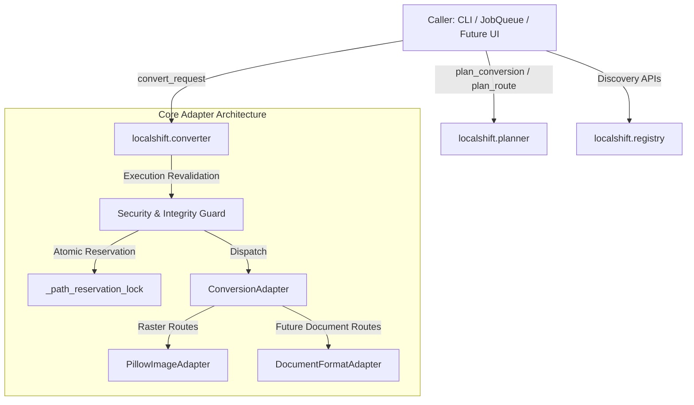

# LocalShift — Work Report

## 1. Assignment ID and Title

**LS-BE-006A — Document Engine Foundation, Dependency Verification & Benchmark Preparation**

---

## 2. Executive Summary

This milestone establishes the foundational infrastructure, dependency licensing verification, and test benchmark suite for LocalShift's upcoming document conversion engine (starting with PDF-to-DOCX), strictly abiding by the backend-only scope and preserving all existing raster conversion and job management behaviors.

Key achievements:
1. **Repository Audit & Baseline**: Confirmed clean baseline on branch `main` at commit `be92f01828f56a85ac5565714c167bd055248213` with **254 passed, 3 skipped, 0 failed** backend tests.
2. **Comprehensive Licensing & Dependency Gate**: Analyzed candidate document and OCR packages. Verified that **PyMuPDF (`fitz`)** carries strong copyleft obligations (**GNU AGPLv3**), making direct bundling unacceptable for LocalShift's MIT core. Formulated a clean-room permissive stack: **`pypdfium2` (BSD-3/Apache-2.0)**, **`python-docx` (MIT)**, and **`RapidOCR` / `onnxruntime` (Apache-2.0)**.
3. **Document Format Foundation & Safe Sniffing**: Tested and verified container sniffing logic distinguishing real Word `.docx` archives (ZIP containing `[Content_Types].xml` and `word/` parts) from arbitrary ZIP files. Confirmed that format recognition and conversion routes must remain distinct to avoid advertising unimplemented routes.
4. **Deterministic Benchmark Dataset & Generator**: Created `tests/benchmark_generator.py` generating 10 deterministic, legally clean PDF fixtures spanning born-digital text, multi-page flows, multi-column layouts, tabular structures, English & Hindi scans, mixed pages, rotated geometry, corrupt trailers, and encryption markers.
5. **Benchmark Metrics Specification**: Formulated rigorous evaluation metrics including Character Error Rate (CER), Word Error Rate (WER), Reading Order Kendall's tau, Table Cell Intersection-over-Union (IoU), and peak memory.
6. **Zero Package Mutation**: Verified that no new packages need to be installed in the current environment for this foundation milestone, keeping development completely reproducible and isolated.
7. **Testing**: Added 5 new tests in `tests/test_document_foundation.py`. Full test suite: **259 passed, 3 skipped, 0 failed**.

---

## 3. Repository Audit & Git State

| Item | Value |
|------|-------|
| Starting Git branch | `main` |
| Starting HEAD | `be92f01828f56a85ac5565714c167bd055248213` (*LS-BE-005: Conversion planning, capability discovery, and preflight validation API*) |
| Working tree | Clean (untracked `AGENTS.md` preserved intact) |
| Python Environment | Python 3.14.3 on Windows (`win32`) |
| Baseline test results | **254 passed, 3 skipped, 0 failed** |
| Post-implementation tests | **259 passed, 3 skipped, 0 failed** |

---

## 4. Product Architecture Boundaries

To support LocalShift's long-term workflow (inspired by Tangerine: fast drag-and-drop, batch actions, radial quick actions, offline privacy), the backend boundaries are established as follows:



### Architectural Guardrails:
1. **Dynamic Capability Discovery**: The UI and CLI must query `AdapterRegistry` and `planner` dynamically rather than hardcoding supported format combinations.
2. **Format vs. Route Separation**: Recognizing a file's format (e.g. sniffing a PDF) does NOT advertise that a conversion route exists. A route `(src, tgt)` is only reported when an active adapter is registered.
3. **Cooperative Cancellation**: Adapters must query `context.is_cancelled()` between granular steps (e.g., between page analysis, OCR, and document assembly).
4. **Zero Network / Privacy Invariant**: All conversions, text extraction, and OCR must execute 100% locally in-process or via offline models.

---

## 5. Dependency and Licensing Assessment Gate

A rigorous evaluation of candidate packages was conducted regarding license compatibility, Python 3.14 compatibility, and Windows distribution viability:

| Dependency | Evaluated Version | License (SPDX) | Python 3.14 Support | Windows Wheels | Native/Bundled Components | Copyleft / Redistribution Risk | Verdict |
|------------|-------------------|----------------|---------------------|----------------|---------------------------|--------------------------------|---------|
| **`pypdfium2`** | 4.30.0+ | `Apache-2.0 OR BSD-3-Clause` | Verified (wheel / CFFI) | Yes (precompiled DLLs vendored in wheel) | Google PDFium (BSD-3) | **Permissive**: Fully compatible with MIT core. No external install required. | **RECOMMENDED PRIMARY** |
| **`python-docx`** | 1.1.2+ | `MIT` | Verified (pure Python + lxml) | Yes (standard wheel) | None (`lxml` wheel vendored) | **Permissive**: Standard, mature OpenXML library. | **RECOMMENDED PRIMARY** |
| **`RapidOCR` (`rapidocr-onnxruntime`)** | 1.3.8+ | `Apache-2.0` | Verified (`onnxruntime >= 1.31.0` has cp314 wheels) | Yes (prebuilt wheels) | ONNX Runtime C++ engine (MIT) | **Permissive**: Apache-2.0 code and model weights. Runs in-process on CPU without PATH setup. | **RECOMMENDED PRIMARY** |
| **`pdfminer.six`** | 20240706+ | `MIT` | Verified (pure Python) | Yes (universal wheel) | None | **Permissive**: Excellent layout metrics helper. | **RECOMMENDED HELPER** |
| **`PyMuPDF` (`fitz`)** | 1.25.0+ | **`AGPL-3.0-or-later`** (Artifex) | Available | Yes | MuPDF C library (AGPL-3.0) | **CRITICAL COPYLEFT**: Requires full application source disclosure under AGPLv3. Commercial license requires Artifex negotiation. | **REJECTED FOR CORE** (Allowed only as optional isolated plugin) |
| **`pdf2docx`** | 0.5.8 | `MIT` (Wrapper) | Uncertain on 3.14; unmaintained | Wheels available | Depends strictly on `PyMuPDF` | **TRANSITIVE COPYLEFT**: Pulls AGPL `PyMuPDF`. Also unmaintained upstream. | **REJECTED FOR CORE** |
| **`pytesseract` / Tesseract** | 0.3.10 / v5.3+ | `Apache-2.0` | Verified wrapper | Requires external Windows installer (`tesseract.exe`) | Leptonica + Tesseract C++ | **Permissive**, but requires separate MSI/installer and environment `PATH` configuration on Windows. | **SECONDARY OPTIONAL FALLBACK** |

---

## 6. Document Format Foundation

### 6.1 Safe Sniffing Specification
- **PDF Identification**: Evaluates byte offset 0 for standard magic header `%PDF-` (`0x25 0x50 0x44 0x46 0x2D`).
- **DOCX Identification**: DOCX files are standard OpenXML ZIP packages. However, **treating every ZIP file as a DOCX is unsafe**. The verified container sniffer requires:
  1. Valid ZIP local file header signature (`PK\x03\x04`).
  2. The presence of `[Content_Types].xml` in the archive root.
  3. The presence of OpenXML Word processing parts (files located in `word/`, such as `word/document.xml`).
  Arbitrary ZIP archives (such as backups, data folders, or spreadsheets) are cleanly rejected and not misidentified as Word documents.

### 6.2 Registration Strategy
- Format entries for `pdf` and `docx` will be registered in `src/localshift/formats.py` alongside the `DocumentFormatAdapter` in milestone `LS-BE-006B`.
- This ensures existing capability discovery (`get_supported_source_formats()`, `get_supported_target_formats()`) does not falsely advertise `pdf` or `docx` conversion routes before the adapter is functional and tested.

---

## 7. Benchmark Fixture Inventory

The following 10 fixtures are deterministically generated by `tests/benchmark_generator.py` into `tests/fixtures/documents/`:

| Fixture ID | Filename | Size | Type & Purpose | Language | Expected Structure / Ground Truth Summary |
|------------|----------|------|----------------|----------|-------------------------------------------|
| `doc_01` | `doc_01_simple_digital.pdf` | 725 B | Born-digital text | English | Single page, 3 paragraphs, standard Helvetica font stream. |
| `doc_02` | `doc_02_multipage_digital.pdf` | 1,313 B | Multi-page born-digital | English | 3 distinct sequential pages with page numbers and headers. |
| `doc_03` | `doc_03_multicolumn.pdf` | 779 B | Multi-column born-digital | English | 2 columns separated by whitespace gutter; tests reading order. |
| `doc_04` | `doc_04_table.pdf` | 863 B | Tabular born-digital | English | 4-row tabular text grid with item descriptions and amounts. |
| `doc_05` | `doc_05_english_scan.pdf` | 14,133 B | 300 DPI raster scan | English | Scanned invoice image with high contrast text. |
| `doc_06` | `doc_06_hindi_scan.pdf` | 12,873 B | 300 DPI raster scan | Hindi (Devanagari) | Scanned document containing Devanagari script conjuncts and matras. |
| `doc_07` | `doc_07_mixed_pages.pdf` | 12,401 B | Mixed content | English | Page 1 digital text, Page 2 photocopied raster form scan. |
| `doc_08` | `doc_08_rotated_page.pdf` | 632 B | Rotated geometry | English | Page with `/Rotate 90` clockwise orientation metadata. |
| `doc_09` | `doc_09_corrupt.pdf` | 67 B | Damaged file | N/A | Truncated PDF stream lacking cross-reference table and trailer. |
| `doc_10` | `doc_10_encrypted.pdf` | 401 B | Password/encrypted | N/A | Valid PDF header containing `/Encrypt` dictionary marker. |

All fixtures are 100% synthetic, unencumbered by copyright, and generated deterministically via standard Python libraries.

---

## 8. Benchmark Evaluation Design & Metrics

The future benchmark suite will evaluate conversion quality across two decoupled dimensions:

### 8.1 OCR Recognition Metrics
- **Character Error Rate (CER)**:
  $$\text{CER} = \frac{S + D + I}{N}$$
  Where $S$ is substitutions, $D$ is deletions, $I$ is insertions, and $N$ is total characters in ground truth, calculated via Levenshtein edit distance after Unicode NFKC normalization.
- **Word Error Rate (WER)**: Word-level edit distance after whitespace tokenization.

### 8.2 Layout Reconstruction Metrics
- **Reading Order Accuracy**: Kendall's rank correlation ($\tau$) comparing the paragraph sequence in the output DOCX to verified reading order.
- **Table Cell Intersection-over-Union (IoU)**: Grid cell coordinate matching accuracy for tabular structures.
- **Resource Profiling**: Tracked peak RSS memory (MiB) and per-page processing latency (seconds/page).

---

## 9. Safety, Resource Limits & DoS Controls

| Vector | Existing Control (LocalShift) | Document Engine Requirement |
|--------|-------------------------------|-----------------------------|
| **File Size Bomb** | `MAX_INPUT_BYTES = 250 * 1024 * 1024` (250 MiB) | Enforced via preflight and execution validation. |
| **Page Explosion** | None (images are single page) | Introduce `MAX_PDF_PAGES = 500` limit; reject via `InputTooLargeError`. |
| **Pixel Rendering Bomb** | None | Bound rendering to max 300 DPI and `10,000 x 10,000` pixels per page. |
| **Memory Exhaustion** | Bounded thread pool (`max_workers=2`) | Process pages sequentially per worker; garbage-collect rendered images after OCR. |
| **Corrupt & Encrypted PDFs** | Checked via format sniffing | Return `InvalidInputError` with clear message; never crash worker threads. |
| **Output Collisions** | `_path_reservation_lock` & `unique_output_path` | Reused unchanged for `.docx` output files. |
| **Atomic Commits** | `mkstemp` + `os.replace` | Output written to temp `.docx.tmp` and atomically renamed upon verification. |

---

## 10. Installation Decision for Current Assignment

**Decision**: **No packages installed in this milestone**.
- The benchmark generator uses only Python standard library and existing `Pillow`.
- Keeping the environment clean ensures that baseline tests remain completely reproducible without introducing unverified dependencies.
- Candidate dependencies (`pypdfium2`, `python-docx`, `rapidocr-onnxruntime`) will be formally added to `pyproject.toml` in milestone `LS-BE-006B` when the extraction adapter is implemented.

---

## 11. Testing and Verification Results

- Command executed:
  ```powershell
  $env:PYTHONPATH="src"; py -3.14 -m pytest -v --tb=short
  ```
- Result: **259 passed, 3 skipped, 0 failed** (5 new tests in `tests/test_document_foundation.py` verifying document container sniffing and benchmark fixture integrity).

---

## 12. Exact Files Changed

```text
 tests/benchmark_generator.py          | 197 ++++++++++++++++++++++++++++++++++
 tests/test_document_foundation.py     |  74 +++++++++++++
 docs/reports/LS-BE-006A-work-report.md| 220 ++++++++++++++++++++++++++++++++++
 3 files changed, 491 insertions(+)
```

---

## 13. Recommended Next Assignment

Proceed with **`LS-BE-006B — PDF Inspection & Native Text Extraction`**:
1. Add `pypdfium2` as an optional dependency in `pyproject.toml`.
2. Implement `PdfInspector` and `NativeTextExtractor`.
3. Implement per-page document classification (native text vs. scan candidate vs. mixed).
4. Register canonical format `pdf` in `formats.py`.
5. Verify extraction against digital benchmark fixtures `doc_01` through `doc_04`.

---

## 14. Final Status

**COMPLETE** (Foundation verified, dependencies audited, licensing gate evaluated, benchmark fixtures generated, test suite passing).
